<div align="center">

<p align="right">
  <strong>English</strong> | <a href="README.zh-CN.md">简体中文</a>
</p>

# 🥗 Nutri-RAG

**Health-diet Q&A via Retrieval-Augmented Generation** — the LLM research module of the MetaNutri ecosystem

[](https://metanutri-ai-rag-question-answering.streamlit.app/)
[](https://github.com/ElijahZhao/MetaNutri-Ai-RAG/actions/workflows/ci-gates.yml)
[](LICENSE)
[]()
[]()
[]()
[]()

</div>

**Nutri-RAG** is a research-grade RAG application that answers health-diet questions grounded in official Chinese nutrition data: the *China Food Composition Tables* (325 foods × 32 nutrients) and the *Dietary Guidelines for Chinese Residents (2022)* (8 principles + detailed practices).

## ✨ Highlights

- **Balanced two-path retrieval** — food chunks and guideline chunks are queried separately with equal quota, so guideline recommendations are never squeezed out by 325 food chunks
- **Citation-grounded answers** — every key claim carries a `[n]` reference to its source chunk, making answers fully traceable
- **Built-in evaluation** — 200-item NutriQA benchmark (composition 60 / guideline 50 / special 50 / refusal 40) with no-RAG vs RAG ablation across 3 commercial models, regenerable with one command
- **Reproducible data pipeline** — official data sources, scraper → clean → chunk → vector store, all scripted
- **Lightweight deployment** — single-process Streamlit app on the free tier; vector store auto-restored from tarball

## 🏗️ Architecture

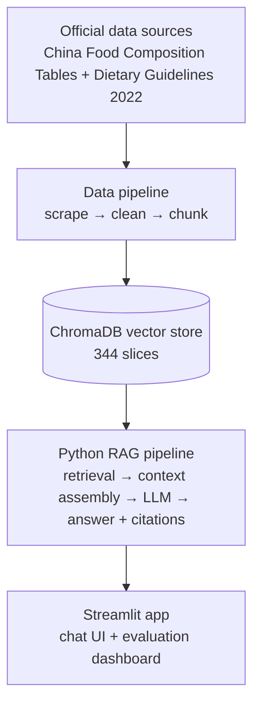

## 🚀 Online Demo

Try it live: **[metanutri-ai-rag-question-answering.streamlit.app](https://metanutri-ai-rag-question-answering.streamlit.app/)**

Ask questions like *"高血压人群饮食上应该注意什么？"* or *"每100克鸡蛋含多少蛋白质？"* — every answer expands to its source citations for verification.

## 🖼️ Screenshots

| Chat · Chinese — every answer carries `[n]` citations | Chat · English — full i18n, answers follow the UI language |
|---|---|
| 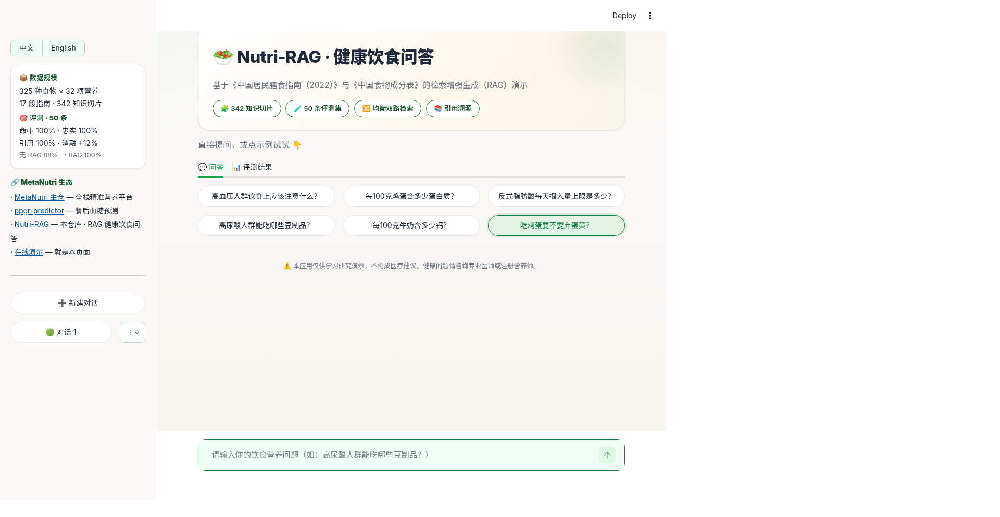 | 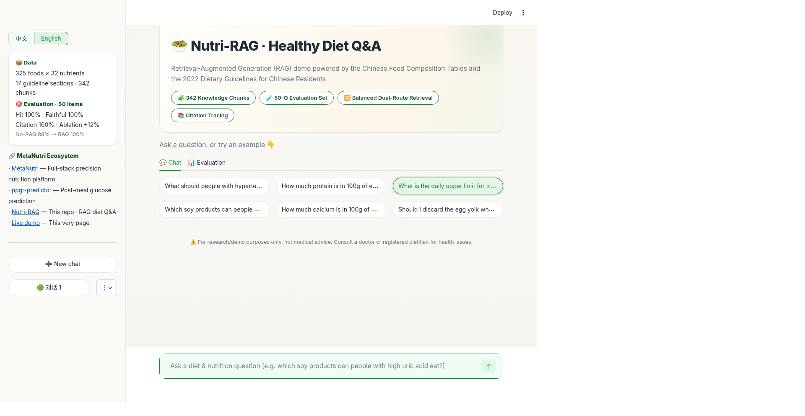 |

| Evaluation dashboard · 50-case coverage matrix (green = covered both ways, orange = RAG-only gain) | Evaluation research (full-page) · 50-case details, refusal, 9-run sweep, hybrid comparison, failure cases — the whole research chain on one page |
|---|---|
| 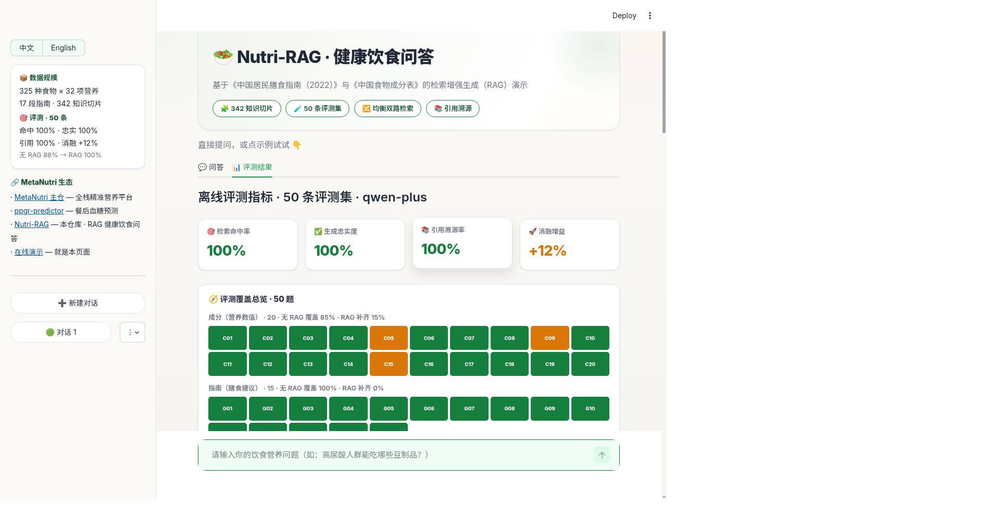 | 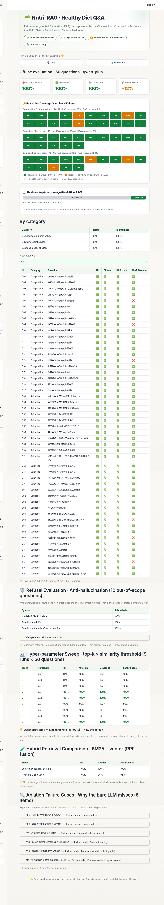 |

## 📊 Paper figures (NutriQA)

Figures from the *NutriQA* paper (git tag `v1.0.0`), regenerable with `docs/figures/make_figures.py` (data read from `data/eval_report*.json` / `data/refusal_report*.json`):

| Fig 1 · NutriQA evaluation pipeline | Fig 2 · RQ1 retrieval ablation (hit rate) |
|---|---|
| 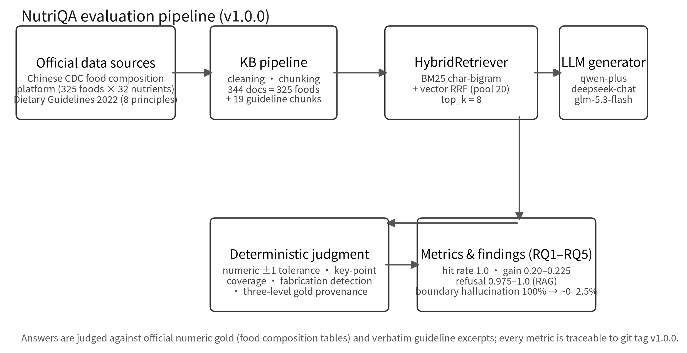 | 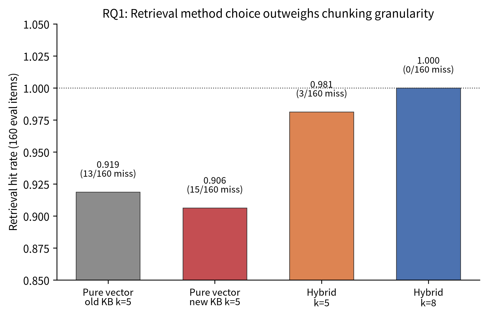 |

| Fig 3 · RQ2 faithfulness by category | Fig 4 · RQ3 refusal under three protocols |
|---|---|
| 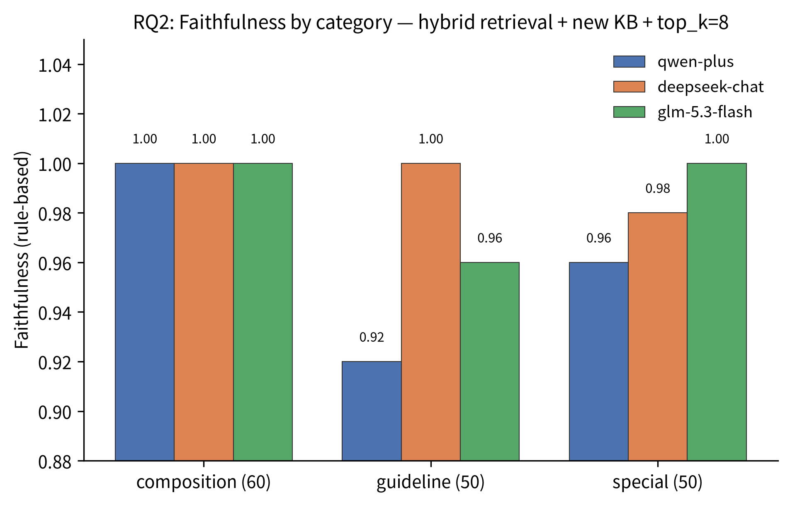 | 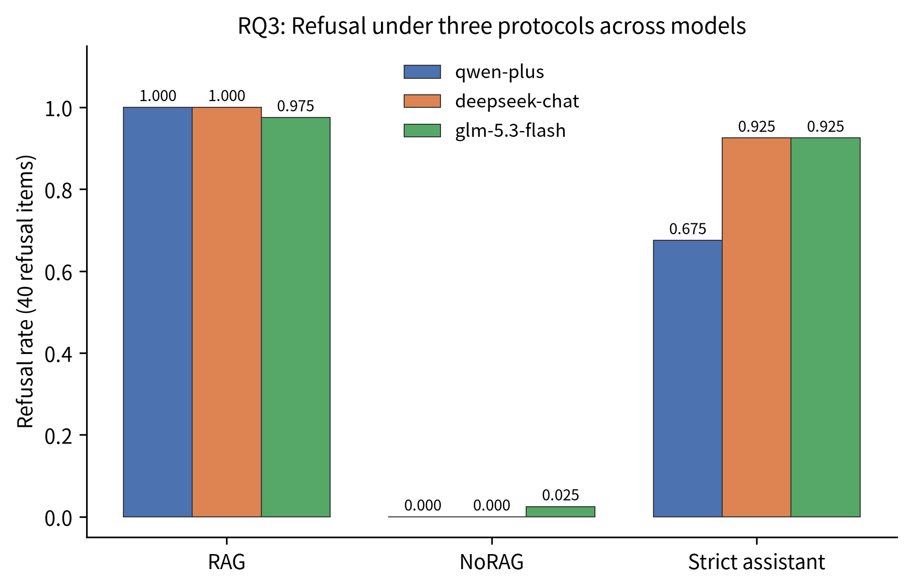 |

| Fig 5 · RQ4 judgment agreement | Fig 6 · RQ5 boundary hallucination |
|---|---|
| 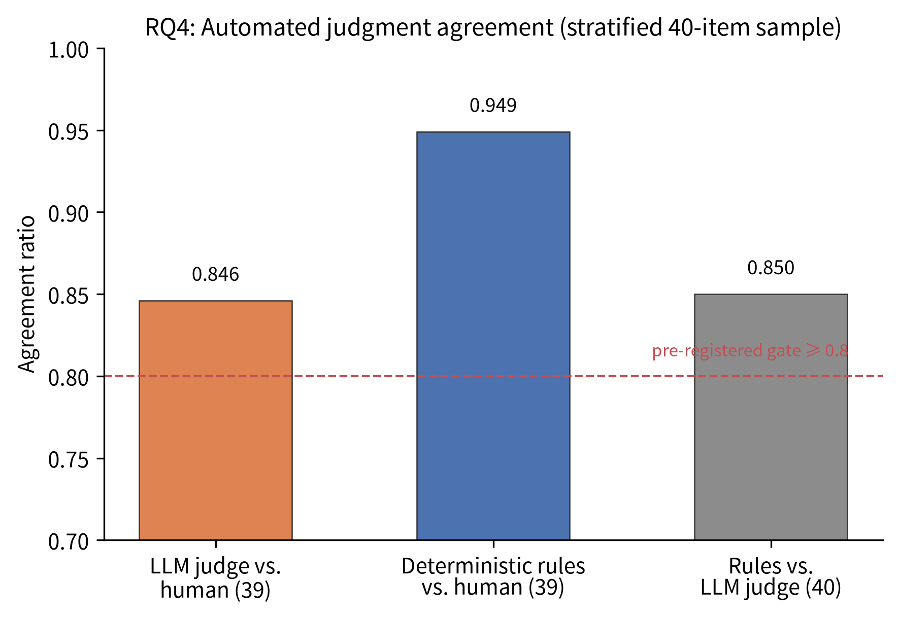 | 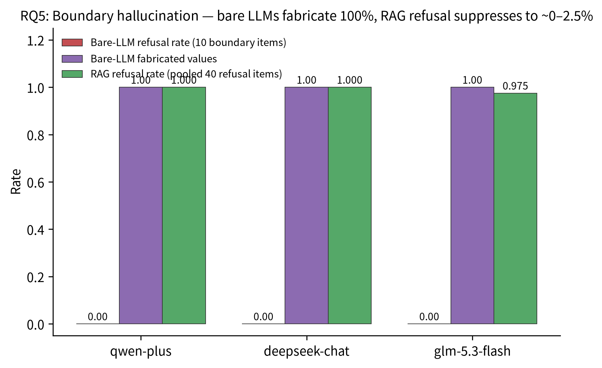 |

## ⚡ Quick Start

```bash
git clone https://github.com/ElijahZhao/MetaNutri-Ai-RAG.git
cd MetaNutri-Ai-RAG
pip install -r requirements.txt

# configure your Alibaba Bailian API key in .env:
#   DASHSCOPE_API_KEY=sk-...

# optional: rebuild the vector store (auto-restored from data/chroma_db.tar.gz if missing)
python3 src/kb.py --rebuild

streamlit run app.py
```

For deployment on Streamlit Community Cloud: set `DASHSCOPE_API_KEY` in **Advanced settings → Secrets** (TOML format), as shown in `.streamlit/secrets.toml.example`.

## 📁 Structure

```
├── app.py                  # Streamlit demo: chat + citations + eval dashboard
├── src/
│   ├── config.py           # pipeline configuration
│   ├── retrieval.py        # balanced two-path retrieval (food + guideline)
│   ├── generation.py       # context assembly + LLM answer with [n] citations
│   ├── kb.py               # vector store build/rebuild (ChromaDB)
│   └── evaluation.py       # 160-case eval + no-RAG vs RAG ablation (HybridRetriever)
├── data/
│   ├── fetch_*.py          # data collection scripts (official sources)
│   ├── build_kb_texts.py   # chunking
│   ├── build_eval_set.py   # eval set generation
│   ├── eval_questions.json # 160-case eval set
│   ├── eval_report.json    # latest evaluation report
│   ├── kb_foods.txt        # 325 food chunks
│   ├── kb_guidelines.txt   # 19 guideline chunks
│   ├── chroma_db.tar.gz    # vector store backup (344 slices)
│   └── SOURCES.md          # data provenance registry
└── requirements.txt
```

## 🧰 Tech Stack

| Component | Choice |
|---|---|
| Language | Python 3.12 |
| Demo UI | Streamlit |
| Vector store | ChromaDB (embedded, file-based) |
| Embedding | `text-embedding-v3` (Alibaba DashScope) |
| LLM | `qwen-plus` (OpenAI-compatible endpoint) |
| Eval | NutriQA benchmark (200 items) — see [`docs/eval-benchmark-spec.md`](docs/eval-benchmark-spec.md) |

## 📊 Evaluation

**Current benchmark (NutriQA v1.0.0)** — 200 items (composition 60 / guideline 50 / special 50 / refusal 40), hybrid retrieval (BM25 char-bigram + vector RRF, top_k=8), KB = 344 docs (325 foods + 19 guideline chunks), three commercial models. All numbers below are regenerated from `data/eval_report*.json` / `data/refusal_report*.json`; see the NutriQA paper (title page + `docs/figures`, pinned at tag v1.0.0).

Generation evaluation (160 items):

| Metric | qwen-plus | deepseek-chat | glm-5.3-flash |
|---|---|---|---|
| Retrieval hit rate | 1.0 | 1.0 | 1.0 |
| Faithfulness | 0.9625 | **0.9938** | 0.9875 |
| Gold cover (RAG → NoRAG) | 0.9625 → 0.7625 | 0.9938 → 0.7688 | 0.9875 → 0.7625 |
| **RAG gain** | 0.20 | 0.225 | 0.225 |

Refusal evaluation (40 items):

| Protocol | qwen-plus | deepseek-chat | glm-5.3-flash |
|---|---|---|---|
| RAG (with retrieved context) | 1.0 | 1.0 | 0.975 |
| NoRAG (bare LLM) | 0.0 | 0.0 | 0.025 |
| Strict (refuse instruction) | 0.675 | 0.925 | 0.925 |

Boundary hallucination (10 out-of-KB × numeric-bait items): bare LLMs fabricate numeric values **100%** across all three models; RAG refusal suppresses this to ~0–2.5%.

Automated-judgment gate (stratified 40-item sample, 39 valid): deterministic rules–human **0.949**, LLM-judge–human 0.846, rules–LLM-judge 0.850.

---

_Below: the historical 50-case baseline (superseded by the v1.0.0 benchmark above), then the earlier research extensions — refusal, hyper-parameter sweep, hybrid-retrieval comparison and failure attribution._

Offline evaluation on 50 hand-verified cases (20 composition / 15 guideline / 15 special; gold answers are real CSV values or verbatim guideline text — none hand-written), qwen-plus, 100 LLM calls total:

| Metric | Score |
|---|---|
| Retrieval hit rate | **100%** (50/50) |
| Generation faithfulness | **100%** (50/50) |
| Citation rate | **100%** (50/50) |
| Gold-info coverage, no-RAG → RAG | **88% → 100%** |

Per category — all three at **1.0** (retrieval hit & faithfulness). The ablation gap concentrates on corpus-specific values (e.g. milk calcium, lean pork protein, sweet potato energy) that a bare LLM cannot recall; RAG answers are additionally fully citation-traceable.

Why the bare LLM misses exactly those cases (precision loss, regional-data mismatch, stance blending, framework mismatch): see [`docs/error-analysis.md`](docs/error-analysis.md).

Regenerate: `python3 src/evaluation.py`

**Refusal evaluation (anti-hallucination)** — 10 out-of-scope questions (6 off-topic + 4 not-in-KB foods/scenarios): how often does the system refuse instead of fabricating?

| System | Refusal rate |
|---|---|
| **Nutri-RAG (RAG)** | **100%** (10/10) |
| Bare LLM (no RAG) | 0% (0/10) — fabricates nutrition facts |
| Bare LLM + "refuse" instruction | 80% (8/10) |

The 100% RAG refusal rate shows that *retrieval + an explicit knowledge-base boundary* — not prompting alone — is what prevents hallucination. Regenerate: `python3 src/eval_refusal.py`

**Hyper-parameter sweep** — 9 configurations (top-k ∈ {3,5,8} × similarity threshold ∈ {0.2,0.35,0.5}) on the 50-case eval set (450 LLM calls):

| top-k | threshold | Retrieval hit | Citation | Gold cover | Faithfulness |
|---|---|---|---|---|---|
| 3 | 0.2–0.5 | 94% | 100% | 100% | 100% |
| **5** | **0.2–0.35** | **100%** | **100%** | **100%** | **100%** |
| 5 | 0.5 | 100% | 96% | 100% | 96% |
| 8 | 0.2–0.35 | 100% | 100% | 98% | 98% |
| 8 | 0.5 | 100% | 100% | 100% | 100% |

top-k=3 misses 3 cases (source chunks cannot fit), top-k=8 degrades gold coverage (longer context, occasional omission), and the similarity threshold has little effect until 0.5. **top-k=5 with no threshold is the sweet spot** — and it is now the default. Full table: `data/sweep_report.json` · Regenerate: `python3 src/eval_sweep.py`

**Hybrid retrieval comparison** (char-bigram BM25 + vector, RRF fusion) — 50 cases:

| Mode | Retrieval hit | Citation | Faithfulness |
|---|---|---|---|
| Vector (current default) | 100% | 100% | 100% |
| Hybrid (BM25+vector) | 100% | 96% | 96% |

No retrieval gain (pure vector is already saturated on this set), and the fused context occasionally induces out-of-range citation numbers — so **plain balanced two-path vector retrieval stays the default**. Regenerate: `python3 src/eval_hybrid.py`

## 📚 Data Sources

- **China Food Composition Tables** — National Institute for Nutrition and Health, China CDC ([nlc.chinanutri.cn](https://nlc.chinanutri.cn/fq/))
- **Dietary Guidelines for Chinese Residents (2022)** — Chinese Nutrition Society ([dg.cnsoc.org](http://dg.cnsoc.org/))

Full provenance, scraping scripts and rebuild instructions: [`data/SOURCES.md`](data/SOURCES.md)

## ⚠️ Disclaimer

This project is for research and educational demonstration only. It does not constitute medical advice. For health concerns, consult a licensed physician or registered dietitian.

## 🔗 Ecosystem

Nutri-RAG is the LLM research module of the **MetaNutri** ecosystem:

- **MetaNutri** — full-stack precision-nutrition platform ([repo](https://github.com/ElijahZhao/MetaNutri---AI-) · [demo](https://meta-nutri-ai.vercel.app/))
- **ppgr-predictor** — 2-hour postprandial glucose prediction ([repo](https://github.com/ElijahZhao/MetaNutri-Ai-ppgr-predictor) · [demo](https://metanutri-ai-ppgr-predictor.streamlit.app/))
- **Nutri-RAG** (this repo) — health-diet Q&A via RAG

## ❓ FAQ

- **Why not a full-stack app?** The RAG narrative lives in the retrieval pipeline, citation grounding and evaluation — full-stack engineering is already demonstrated by MetaNutri itself.
- **Where does the data come from?** Official public sources only; every step is scripted and reproducible.
- **What does it cost to run?** Near-zero: all heavy computation is on the API side; the free Streamlit tier is sufficient.

## 🎓 Portfolio narrative

For applicants & interviewers: how to tell the Nutri-RAG story — one-liner, PS paragraph, resume bullets, three-repo ecosystem narrative and interview Q&A → [`docs/portfolio-narrative.md`](docs/portfolio-narrative.md).

## 📄 License

[MIT](LICENSE) — consistent with the MetaNutri ecosystem (MetaNutri & ppgr-predictor).

## 📝 Changelog

- **v0.6** — Portfolio & robustness: portfolio narrative guide, EN/zh evaluation research screenshots, publication-opportunity memo, readable API-failure handling (no more crash page)
- **v0.5** — UI & i18n: full English interface, streaming answers, warm theme, 4-block evaluation panel, 8 English example questions (4×2)
- **v0.4** — Research suite: refusal evaluation (10 out-of-scope cases), 9-run hyper-parameter sweep, hybrid-retrieval comparison, failure attribution (6 no-RAG cases)
- **v0.3** — Streamlit demo (chat + citations + eval dashboard), deployed
- **v0.2** — RAG pipeline: balanced two-path retrieval, generation with citations, 50-case eval + ablation
- **v0.1** — Data pipeline: 325 foods × 32 nutrients, 17 guideline chunks, 342-chunk vector store
