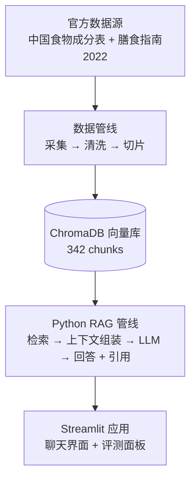
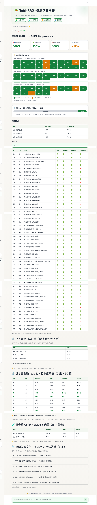

<div align="center">

<p align="right">
  <a href="README.md">English</a> | <strong>简体中文</strong>
</p>

# 🥗 Nutri-RAG

**基于检索增强生成（RAG）的健康饮食问答** — MetaNutri 生态的 LLM 研究模块

[](https://metanutri-ai-rag-question-answering.streamlit.app/)
[](https://github.com/ElijahZhao/nutri-rag/actions/workflows/ci-gates.yml)
[](LICENSE)
[]()
[]()
[]()
[]()

</div>

**Nutri-RAG** 是一个研究型 RAG 应用，基于官方中文营养数据回答健康饮食问题：*《中国食物成分表》*（325 种食物 × 32 项营养指标）与 *《中国居民膳食指南（2022）》*（平衡膳食八准则 + 详细实践）。

## ✨ 核心亮点

- **均衡双路检索** — 食物切片与指南切片按等额配额分别检索，指南建议不会被 325 条食物切片挤出召回窗口
- **引用溯源回答** — 每条关键信息都带 `[n]` 引用编号指向来源切片，回答全程可核验、无虚构数值
- **内置评测** — 50 条评测集（成分 / 指南 / 禁忌三类）+ 无 RAG vs RAG 消融对比，一条命令可复现
- **可复现数据管线** — 官方数据源，采集 → 清洗 → 切片 → 入库全程脚本化
- **轻量部署** — 单进程 Streamlit 应用跑在免费层，向量库缺失时自动从备份解压恢复

## 🏗️ 架构



## 🚀 在线演示

立即体验：**[metanutri-ai-rag-question-answering.streamlit.app](https://metanutri-ai-rag-question-answering.streamlit.app/)**

试试 *"高血压人群饮食上应该注意什么？"* 或 *"每100克鸡蛋含多少蛋白质？"* —— 每条回答都可展开查看引用来源进行核验。

## 🖼️ 界面截图

| 问答界面（中文）—— 每条回答带 `[n]` 引用编号指向来源切片 | 问答界面（英文）—— 全界面中英切换，回答语言跟随界面语言 |
|---|---|
|  |  |

| 评测面板 —— 50 条评测覆盖矩阵（绿色 = RAG 与无 RAG 均覆盖，橙色 = RAG 增量补齐） | 评测研究面板（整页长图）—— 50 题评测明细 + 拒答评测 + 超参数消融（9 组）+ 混合检索对比 + 消融失败案例，一页看完整条研究链 |
|---|---|
|  |  |

## ⚡ 快速开始

```bash
git clone https://github.com/ElijahZhao/nutri-rag.git
cd nutri-rag
pip install -r requirements.txt

# 在 .env 中配置阿里云百炼 API Key：
#   DASHSCOPE_API_KEY=sk-...

# 可选：重建向量库（缺失时会自动从 data/chroma_db.tar.gz 恢复）
python3 src/kb.py --rebuild

streamlit run app.py
```

部署到 Streamlit Community Cloud：在 **Advanced settings → Secrets** 中以 TOML 格式配置 `DASHSCOPE_API_KEY`，参见 `.streamlit/secrets.toml.example`。

## 📁 目录结构

```
├── app.py                  # Streamlit 演示：问答 + 引用 + 评测面板
├── src/
│   ├── config.py           # 管线配置
│   ├── retrieval.py        # 均衡双路检索（食物 + 指南）
│   ├── generation.py       # 上下文组装 + LLM 回答（带 [n] 引用）
│   ├── kb.py               # 向量库构建/重建（ChromaDB）
│   └── evaluation.py       # 50 条评测 + 无 RAG vs RAG 消融
├── data/
│   ├── fetch_*.py          # 数据采集脚本（官方数据源）
│   ├── build_kb_texts.py   # 知识切片
│   ├── build_eval_set.py   # 评测集生成
│   ├── eval_questions.json # 50 条评测集
│   ├── eval_report.json    # 最新评测报告
│   ├── kb_foods.txt        # 325 条食物切片
│   ├── kb_guidelines.txt   # 17 段指南切片
│   ├── chroma_db.tar.gz    # 向量库备份（342 chunks）
│   └── SOURCES.md          # 数据来源登记
└── requirements.txt
```

## 🧰 技术栈

| 组件 | 选型 |
|---|---|
| 语言 | Python 3.12 |
| 演示 UI | Streamlit |
| 向量库 | ChromaDB（嵌入式、文件型） |
| Embedding | `text-embedding-v3`（阿里云百炼） |
| LLM | `qwen-plus`（OpenAI 兼容端点） |
| 评测 | 自建 50 条评测集 + 消融脚本 |

## 📊 评测结果

_以下为 50 条离线评测，以及四项研究扩展——拒答（防幻觉）、超参数消融、混合检索对比、失败归因——每项都有一条命令可复现的报告。_

离线评测：50 条人工核验评测集（成分 20 / 指南 15 / 禁忌 15；gold 全部来自 CSV 真实数值或指南原文，无手编数字），qwen-plus，共 100 次 LLM 调用：

| 指标 | 得分 |
|---|---|
| 检索命中率 | **100%**（50/50） |
| 生成忠实度 | **100%**（50/50） |
| 引用溯源率 | **100%**（50/50） |
| 关键信息覆盖：无 RAG → RAG | **88% → 100%** |

三类（成分 / 指南 / 禁忌）检索命中与忠实度均为 **1.0**。消融差异集中在库内专有数值（如牛奶钙、猪里脊蛋白质、红薯能量）——裸模型答不出，RAG 全部命中且带引用溯源。

裸 LLM 为什么恰好在这 6 条上失手（精度损失 / 区域数据错位 / 立场混合 / 框架错位）：见 [`docs/error-analysis.md`](docs/error-analysis.md)。

重新生成报告：`python3 src/evaluation.py`

**拒答评测（防幻觉）** —— 10 条资料外问题（6 条完全无关 + 4 条不在知识库的食物/场景）：系统在资料不足时是正确拒答，还是编造？

| 系统 | 拒答率 |
|---|---|
| **Nutri-RAG（RAG 管线）** | **100%**（10/10） |
| 裸 LLM（无 RAG） | 0%（0/10）——全部编造营养事实 |
| 裸 LLM + "必须拒答"指令 | 80%（8/10） |

RAG 拒答率 100% 说明：**检索 + 明确的知识库边界**才是防幻觉的根本，仅靠 prompt 提示词不够。报告：`python3 src/eval_refusal.py`

**超参数消融** —— 9 组配置（top-k ∈ {3,5,8} × 相似度阈值 ∈ {0.2,0.35,0.5}）在 50 条评测集上交叉跑（共 450 次 LLM 调用）：

| top-k | 阈值 | 检索命中 | 引用 | 关键覆盖 | 忠实度 |
|---|---|---|---|---|---|
| 3 | 0.2–0.5 | 94% | 100% | 100% | 100% |
| **5** | **0.2–0.35** | **100%** | **100%** | **100%** | **100%** |
| 5 | 0.5 | 100% | 96% | 100% | 96% |
| 8 | 0.2–0.35 | 100% | 100% | 98% | 98% |
| 8 | 0.5 | 100% | 100% | 100% | 100% |

top-k=3 有 3 题源切片挤不进上下文；top-k=8 上下文过长、偶发遗漏关键信息使覆盖掉到 98%；阈值在 0.5 以下影响有限。**top-k=5 且不加阈值是最优点——已设为默认值**。完整表格：`data/sweep_report.json` · 脚本：`python3 src/eval_sweep.py`

**混合检索对比**（字符 bigram BM25 + 向量，RRF 融合）——50 题：

| 模式 | 检索命中 | 引用 | 忠实度 |
|---|---|---|---|
| 纯向量（当前默认） | 100% | 100% | 100% |
| 混合（BM25+向量） | 100% | 96% | 96% |

检索层无增益（纯向量在本评测集上已饱和），且融合上下文偶发诱导越界引用编号——**故保持均衡双路纯向量检索为默认**。脚本：`python3 src/eval_hybrid.py`

## 📚 数据来源

- **中国食物成分表** — 中国疾病预防控制中心营养与健康所（[nlc.chinanutri.cn](https://nlc.chinanutri.cn/fq/)）
- **中国居民膳食指南（2022）** — 中国营养学会（[dg.cnsoc.org](http://dg.cnsoc.org/)）

完整来源登记、采集脚本与重建说明：[`data/SOURCES.md`](data/SOURCES.md)

## ⚠️ 免责声明

本项目仅供学习研究演示，不构成医疗建议。健康问题请咨询专业医师或注册营养师。

## 🔗 生态关联

Nutri-RAG 是 **MetaNutri** 生态的 LLM 研究模块：

- **MetaNutri** — 全栈精准营养平台（[仓库](https://github.com/ElijahZhao/MetaNutri---AI-) · [演示](https://meta-nutri-ai.vercel.app/)）
- **ppgr-predictor** — 餐后 2 小时血糖预测（[仓库](https://github.com/ElijahZhao/ppgr-predictor) · [演示](https://metanutri-ai-ppgr-predictor.streamlit.app/)）
- **Nutri-RAG**（本仓库）— 基于 RAG 的健康饮食问答

## ❓ 常见问题

- **为什么不做全栈应用？** RAG 的叙事核心在检索管线、引用溯源与评测——全栈工程能力已由 MetaNutri 展示。
- **数据从哪来？** 仅官方公开数据源，全程脚本化可复现。
- **运行成本？** 几乎为零：重计算全在 API 侧，Streamlit 免费层即可。

## 🎓 作品集叙事

面向申请者与面试官：如何讲好 Nutri-RAG 的故事——一句话简介、PS 段落、简历 bullet、三仓生态叙事与面试 Q&A → [`docs/portfolio-narrative.md`](docs/portfolio-narrative.md)。

## 📄 开源协议

[MIT](LICENSE) —— 与 MetaNutri 生态（MetaNutri 与 ppgr-predictor）保持一致。

## 📝 更新日志

- **v0.6** — 作品集与健壮性：作品集叙事指南、中英评测长图、论文机会备忘、API 异常兜底（不再崩溃页）
- **v0.5** — 界面与国际化：英文界面、流式输出、暖色主题、四区块评测面板、8 个英文示例问题（4×2）
- **v0.4** — 研究增强套件：拒答评测（10 条资料外问题）、9 组超参数消融、混合检索对比、失败归因（6 条无 RAG 案例）
- **v0.3** — Streamlit 演示（问答 + 引用 + 评测面板），已部署上线
- **v0.2** — RAG 管线：均衡双路检索、带引用生成、50 条评测 + 消融
- **v0.1** — 数据管线：325 食物 × 32 营养项、17 段指南切片、342-chunk 向量库
